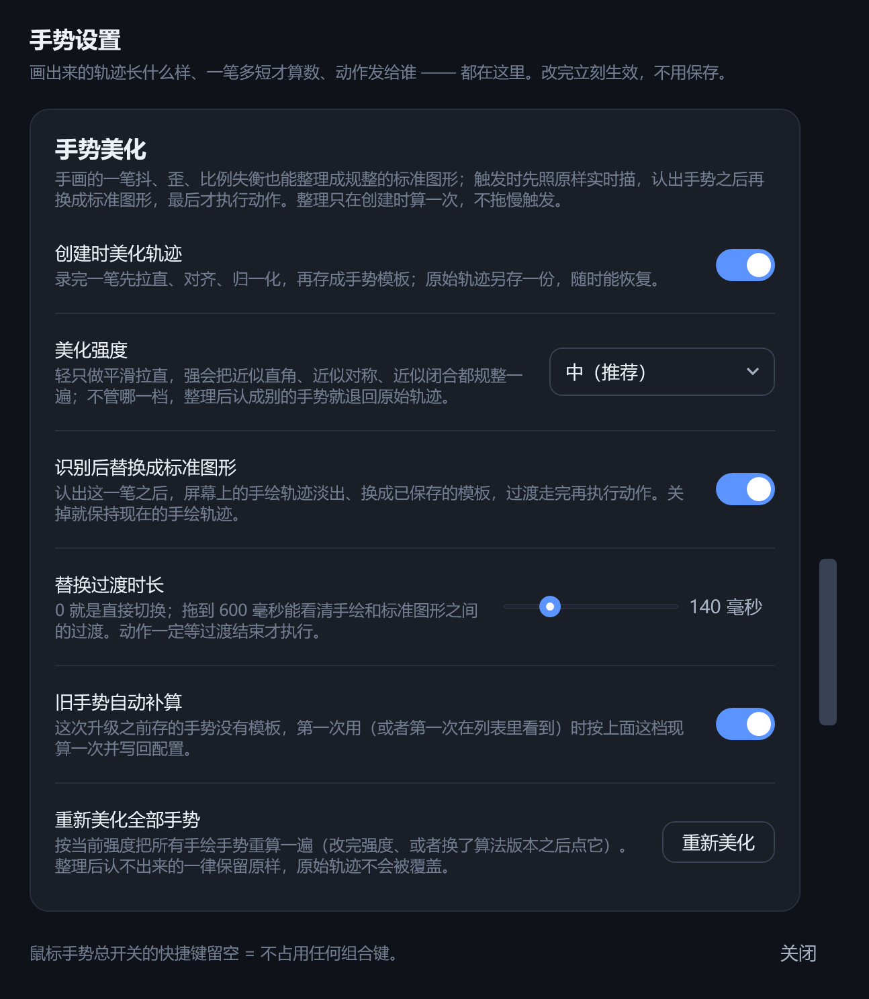

# 鼠标手势「创建时美化 + 匹配后替换」实现说明

日期：2026-11-21　范围：Input Plus 鼠标手势模块（**不含** Qbar、**不含**按住拖拽）

---

## 1. 目标与结果

| 需求 | 落地结果 |
| --- | --- |
| A 创建手势时把 Raw Stroke 整理成标准图形（去抖 → 重采样 → 关键点 → 几何规整 → 归一化） | 新增 `Core/Gestures/StrokeBeautifier.cs`，三档强度，输出 64 点模板 |
| 必须用现有识别器校验美化前后是同一手势，否则降档/保留原始轨迹并记日志 | 三道守门：方向串一致、`GestureEngine.Distance ≤ 档位上限`、双向 Hausdorff；不过就降一档，全不过保留原样并写日志 |
| 原始轨迹必须保留 | `MouseGesture.RawPath` 存原始像素轨迹，详情页可「恢复原始轨迹」 |
| B 触发时先原样描，认出来之后替换成模板，替换完再执行 | `GestureOverlayWindow.ReplaceTrailWithTemplate()` + `GestureService.FinishHit()`，过渡 140ms（0–600 可调） |
| 未匹配不替换、按原逻辑淡出 | 未命中仍走 `HideOverlay(0)`，模板层只由命中/立即执行两条路径触发 |
| C 设置持久化 | `GestureOptions` 五个新字段，走整对象 JSON，改完即时落盘 |
| D 只在创建时算、点数上限、可重新美化、旧手势回填 | 计算只在录制/回填/手动重建时发生；`MaxRawPoints=2000`；设置页「重新美化」；`TemplateVersion` 过期自动重建 |
| E 验收 | 自检 35 条 + `--drag-e2e` 回归 + `--render` 出图，见第 7 节 |

---

## 2. 变更文件清单

| 文件 | 归属 | 作用 |
| --- | --- | --- |
| `src/InputPlus/Core/Gestures/StrokeBeautifier.cs`（新增） | 手势 | 美化算法本体：档位参数、`TryBuild`、三道守门、闭环拟合、圆角、方向基准 |
| `src/InputPlus/Core/Gestures/GestureBeauty.cs`（新增） | 手势 | 模型落库层：`Apply/Rebuild/Ensure/Clear/UseRaw/Describe`，日志与异常兜底 |
| `src/InputPlus/Core/Gestures/GestureModels.cs` | 手势 | `MouseGesture` 增加 `Beauty/RawPath/BeautyLevel/BeautyVersion/HasBeauty/HasRaw/DisplayPoints`；`GestureOptions` 增加五项设置；`Clone/CopyFrom` 同步 |
| `src/InputPlus/Core/Gestures/GestureEngine.cs` | 手势 | 模板缓存指纹加入 Beautylevel/Beauty 哈希；`ShapeOf` 优先用模板 |
| `src/InputPlus/UI/GestureService.cs` | 手势 | 录制落库、命中替换、立即执行、回填、排期取消、Dispose 清理 |
| `src/InputPlus/UI/Windows/GestureOverlayWindow.xaml(.cs)` | 手势 | 三层模板笔、交叉淡入淡出、清除/复位 |
| `src/InputPlus/UI/Windows/GestureRecordWindow.xaml.cs` | 手势 | 录制结果带上原始像素轨迹，完成页预览美化后的形状 |
| `src/InputPlus/UI/Views/GesturesView.xaml(.cs)` | 手势 | 列表缩略图/详情预览优先画模板；「模板：…」状态行 + 「重新美化」「恢复原始轨迹」 |
| `src/InputPlus/UI/Views/GestureOptionsView.xaml(.cs)` | 手势 | 「手势美化」设置卡（五项设置 + 重新美化全部） |
| `src/InputPlus/UI/Windows/GestureSettingsWindow.xaml.cs` | 手势 | 出图用的滚动锚点透传 |
| `src/InputPlus/UI/RenderTools.cs` | 手势（诊断） | 新增 `gestures-prefs-beauty.png` 截图 |
| `src/InputPlus/SelfTest.Gestures.Beauty.cs`（新增）、`SelfTest.cs` | 手势（自检） | 35 条美化断言，注册在「手势美化」小节 |

> 说明：`StrokeCanonicalizer.cs`、`StrokeSmoother.cs` 是 v1.3.1 已有文件，本次未改其行为；美化算法**另起一条链**，不替换原有识别/校正逻辑。

---

## 3. 算法

### 3.1 主流程

1. `Prepare`：去 NaN、去重合点；超过 `MaxRawPoints=2000` 按步长抽样（保证末点留下）。
2. 包围盒对角线 < 24px 视为「点了一下」，不美化。
3. `Normalize`（只平移 + 等比缩放，**不旋转**）→ 方向串基线。
4. 按请求档位 `TryBuild`，失败自动降档（强 → 中 → 轻）。
5. `Resample(Normalize(candidate), 64)` 统一 64 点输出。
6. 三道守门，全过才返回 `Beautified=true`。

### 3.2 `TryBuild` 的几何规整

| 步骤 | 做什么 | 为什么 |
| --- | --- | --- |
| 闭环拟合 | 累计转角判 `IsLoop`，首尾距 ≤ 长边 35%、径向偏差 ≤ 0.22 时拟合成 64 点椭圆，保留绕向 | 圆/Q 的圈拟合比抽稀成多边形好看，且不改方向语义 |
| 平滑 | 滑动平均，首尾钉死 | 去手抖，端点不动 |
| 重采样 | 按弧长 `clamp(len/3, 48, 180)` | 让后续几何判定与采样率无关 |
| 简化 | `GestureEngine.Simplify`（档位 epsilon） | 抽掉冗余点，露出真正的拐角 |
| 切段 | 转角 > 档位阈值且段长 ≥ `MinSegment` 处切；共线 < 8° 合并 | 得到"笔画骨架" |
| 对称 | 垂直轴镜像误差 ≤ 尺度 10% 时成对拉一半（i ↔ n-1-i） | 保起笔/收笔顺序，方向语义不丢 |
| 正交化/吸附 | 段方向吸到 45° 倍数，段长默认不变（强档向平均长度混 0.45） | 竖线拉直、横线拉平、L 变直角 |
| 圆角 | 半径 `min(r, min(l1,l2)*0.45)`，二次贝塞尔 6 段 | 中/强档更像"标准图形" |
| 闭合 | 近似闭合（首尾 ≤ 长边 10%）就真的闭合 | 圈不留豁口 |

### 3.3 三档参数（`StrokeBeautifier.cs`）

| 参数 | 轻 | 中（默认） | 强 |
| --- | --- | --- | --- |
| 平滑窗口/遍数 | 3 / 1 | 5 / 2 | 7 / 2 |
| 简化 epsilon | 6 | 12 | 18 |
| 切角阈值 | 34° | 30° | 26° |
| 最短段 | 18 | 20 | 22 |
| 吸附角度 | 8° | 12° | 16° |
| 圆角半径 | 0 | 10 | 16 |
| 段长混合 | 0 | 0 | 0.45 |
| 对称/闭环拟合 | 否/否 | 是/是 | 是/是 |
| 识别器距离上限 | 0.040 | 0.055 | 0.075 |
| Hausdorff 上限（×长边） | 0.16 | 0.22 | 0.28 |

> 命中阈值本身（`GestureOptions.WgThreshold=0.05`）**没有改**。美化只改形状与显示，不改识别规则。

### 3.4 守门与回退

```csharp
// StrokeBeautifier.cs:255
public static StrokeBeautifyResult Beautify(
    IReadOnlyList<GestureMath.Pt>? raw, StrokeBeautyLevel level, string? expectedPattern = null)
...
string rawPattern = GesturePattern.FromNormalized(rawNorm);

/* 语义基准优先用手势存档的方向串：它才是"这条手势在识别器里的身份"。
 * 没有存档方向（新笔直录、导入）时才用原轨迹的即时判定。 */
string before = GesturePattern.Clean(expectedPattern);
bool fromExpectation = before.Length > 0 && before != GesturePattern.Wildcard;
if (!fromExpectation) before = rawPattern;
...
for (var tryLevel = level; tryLevel >= StrokeBeautyLevel.Light; tryLevel--)
{
    var candidate = TryBuild(rawNorm, tryLevel);
    ...
    if (!Gate(rawNorm, candidate, before, tryLevel, out double deviation, out string why))
        continue;
    ...
}
return Unchanged(rawNorm, level, "美化后语义或形状偏差过大，已保留原始轨迹", before, before, rawPattern);
```

`Gate` 三条：方向串相等；`GestureEngine.Distance`（把原轨迹当模板）≤ 档位上限；双向 Hausdorff ≤ 长边 × 档位系数。

**实测为什么需要 `expectedPattern`**（探针 `%TEMP%\strokelab`，反射调私有 `TryBuild/Gate`）：

- 24 步、±5px 抖动的 L：三档 `TryBuild` 都输出 `→↓`，但 `FromNormalized(原始)` 与 `FromPoints(像素, 20, 0.1, 120)` 都把这一笔读成 `↘` —— 识别器的"同向合并"把后段的 → 与 ↓ 并成了斜线。此时美化按 `↘` 校验必然失败。
- 换成真实采样密度（125Hz 鼠标约 10px 一点）的 40 步、±3px 抖动：两种口径都是 `→↓`，美化正常通过。

所以：重抖动直角被识别器读成斜线时，按 A.2 回退是**正确行为**；而"存档方向 `→↓` + 识别器即时判定 `↘`"的笔，现在按存档方向校验，能规整且不丢语义。日志里会写明「方向基准用手势存档 →↓（原轨迹即时判定为 ↘）」。

---

## 4. 运行时：先原样、后替换、再执行

```csharp
// GestureService.cs:1490
private void FinishHit(MouseGesture hit, double px, double py, double score)
{
    ...
    if (!opts.BeautifyOnMatch || !hit.HasBeauty)
    {
        Execute(hit, px, py);
        SettleOverlay(hit, px, py);
        CoreLog.Info($"手势命中：{title}（偏差 {score:0.000}）");
        return;
    }

    Ui(() =>
    {
        void Run() { Execute(hit, px, py); SettleOverlay(hit, px, py); ... }
        played = overlay.ReplaceTrailWithTemplate(template, ms);
        if (played <= 0) { Run(); return; }
        var timer = new DispatcherTimer(DispatcherPriority.Render) { Interval = ... };
        timer.Tick += ... Run();
    });
}
```

- **为什么动作要等过渡结束**：动作常常会打开窗口/切换前台，覆盖层会被压掉或收掉；先执行就看不到"换成模板"这一步。`Finish` 跑在钩子线程，`Ui()` 是 `BeginInvoke`，所以排期用 `DispatcherTimer` 持有，新手势开始 / `Dispose` 时 `CancelMatchReplace()`。
- **立即执行**手势走 `ImmediateHit`：`ms=0`，当场换图、立刻执行（不引入额外延迟）。
- **未匹配**：不碰模板层，仍 `HideOverlay(0)`。
- 覆盖层模板三层（`TemplatePath/TemplateBorderPath/TemplateShadowPath`）与轨迹共用笔刷/粗细/描边，替换时视觉不跳；`BuildTemplateGeometry` 按模板包围盒等比映射进当前笔迹位置（无轨迹时用窗口中心 200 DIP 方框），并保证两轴至少 96 DIP，横线/竖线不会塌成一个点。

---

## 5. 设置、持久化与旧数据

| 设置 | 字段 | 默认 | 范围 |
| --- | --- | --- | --- |
| 创建时美化 | `BeautifyOnCreate` | true | 开关 |
| 美化强度 | `BeautifyLevel` | `medium` | light/medium/strong |
| 认出后替换 | `BeautifyOnMatch` | true | 开关 |
| 替换过渡时长 | `BeautifyTransitionMs` | 140 | 0–600，步 20 |
| 旧手势自动补算 | `BeautifyBackfill` | true | 开关 |

- 落盘：`AppSettings.GestureOptions` 整对象 JSON，`_host.SaveSettings()`，无迁移代码。
- 版本：`StrokeBeautifier.TemplateVersion=1`；`BeautyVersion < TemplateVersion` 的模板判过期，`GestureBeauty.Ensure` 在首次使用（或列表打开）时重建。
- 回填：`Ensure` 需要 `BeautifyOnCreate && BeautifyBackfill && HasPath && (!HasBeauty || 版本过期)`；幂等（第二遍返回 false，不重复写盘）。
- 「重新美化全部」只重算模板，不动 `Pattern`/`Action`；统计「已规整 / 按低一档整理 / 保留原样」。
- 「恢复原始轨迹」把 `Path` 写回 `RawPath` 并清模板（`UseRaw`）；没有原始轨迹的旧手势会明确提示。

---

## 6. 关键代码位置

| 逻辑 | 位置 |
| --- | --- |
| `Beautify` 入口 / 降档 / 守门 | `src/InputPlus/Core/Gestures/StrokeBeautifier.cs:255`、`:285`、`:364` |
| 档位参数表 | `StrokeBeautifier.cs:221-234` |
| `TryBuild`（闭环/平滑/切段/对称/吸附/圆角/闭合） | `StrokeBeautifier.cs:324` |
| 模型落库 / 回填 / 恢复 | `src/InputPlus/Core/Gestures/GestureBeauty.cs`（`Apply/Rebuild/Ensure/UseRaw`） |
| 模板缓存指纹 | `src/InputPlus/Core/Gestures/GestureEngine.cs`（`Fingerprint`、`ShapeOf`） |
| 录制落库点 | `src/InputPlus/UI/GestureService.cs`（录制分支 `GestureBeauty.Apply(recorded, points, opts, "录制")`） |
| 命中替换 | `src/InputPlus/UI/GestureService.cs:1490` |
| 覆盖层替换动画 | `src/InputPlus/UI/Windows/GestureOverlayWindow.xaml.cs`（`ReplaceTrailWithTemplate`） |
| 设置卡 | `src/InputPlus/UI/Views/GestureOptionsView.xaml`（`BeautyCard`） |
| 自检 | `src/InputPlus/SelfTest.Gestures.Beauty.cs`（35 条） |

---

## 7. 验收步骤

### 7.1 手工（画笔规整 + 语义）

1. 设置 → 鼠标手势 → 右上齿轮 → 「手势美化」：保持默认（开 / 中 / 换 / 140ms / 补算）。
2. 录制一笔 **W**（四个拐点、轻微抖）→ 「用这一笔」：详情预览应是四段折线，转角接近直角；保存后列表缩略图同形。
3. 竖线（故意画歪 10°）：预览应拉直；横线同理拉平。
4. 圆圈：预览应闭合、接近正圆，起笔/收笔位置不变。
5. L 形：两段正交，方向仍是"先横后竖"（看方向串/识别结果，不看名字）。
6. 勾形（✓）：长斜 + 短斜，不被掰成直角。
7. 触发同一手势：先看到手绘轨迹，认出后 140ms 内换成模板，然后才执行动作（动作打开的窗口出现在替换之后）。
8. 关闭「创建时美化」再录一笔：预览保持手绘，保存后「模板：原始轨迹」；触发时无替换。
9. 关闭「认出后替换」再触发：看到手绘轨迹直到淡出，动作照常执行。
10. 已有手势点「重新美化」→ 保存后重启程序：模板仍在（持久化）；再点「恢复原始轨迹」→ 预览回到手绘形状，保存后重启仍为原始。
11. 快速连续画两笔、多屏（副屏画）、高 DPI（150%/200%）：轨迹位置与模板位置对齐，无漂移；替换动画不遮挡输入。

### 7.2 自动化

```powershell
# 构建
dotnet build src/InputPlus/InputPlus.csproj -f net10.0-windows -v q --nologo

# 全量自检（含手势美化 35 条）
src/InputPlus/bin/Debug/net10.0-windows/win-x64/InputPlus.exe --selftest

# 按住拖拽回归（确认没被手势改动影响）
"...\InputPlus.exe" --drag-e2e %TEMP%\drag-e2e.txt

# 出图（设置卡与手势页）
"...\InputPlus.exe" --render %TEMP%\iprender
```

---

## 8. 验证记录

| 项 | 结果 |
| --- | --- |
| 构建 `net10.0-windows` | 0 错误；仅 2 条既有 `CS0649 AltDragSink.ButtonProbeForTest` 警告 |
| `--selftest` | 通过 **6139** 项，失败 **0**；「手势美化」小节 35 条全 PASS（抖动 L / 竖线 / 圆圈 / 涂鸦 / 重抖动回退 / 方向基准 / 落库 11 条 / 引擎 3 条 / 覆盖层 5 条） |
| `--drag-e2e` | 退出码 0，5 场景全过：左拖位移 (80,48)、短按左键 0、右键右下 右+80 下+48、右键左上 左−60 上−40、短按右键 0 |
| `--render` | 手势页显示「模板：原始轨迹」+「重新美化」；设置页「手势美化」卡见下图 |



---

## 9. 已知限制

1. **重抖动直角会被识别器读成斜线**：这是现有识别器的既有行为（17px 采样 + ±5px 抖动时后段被"同向合并"）。此时美化按用户 A.2 回退、保留原始轨迹并记日志；真实鼠标采样密度（约 10px）不触发。
2. **替换只改视觉**：模板不参与匹配，命中阈值、识别路径一点没变；替换期间的新手势会取消排期（不会出现"旧模板盖新笔"）。
3. **`RawPath` 只在 `Apply` 时写入**：导入（WGestures）或极早期数据可能没有原始轨迹，此时「恢复原始轨迹」会提示无可用轨迹。
4. **旧数据回填依赖 `BeautifyBackfill`**：关闭后不会自动补算，需要手动「重新美化」。
5. **模板位置按当前笔迹包围盒映射**：这是显示比例映射，不是绝对坐标还原；不同播放尺寸下形状一致、位置跟着笔迹走。
6. **美化卡未做英文翻译**：新增文案走 `loc:T`，但 `en-US.json` 由 `tools/lang/*.tsv` 生成，本次未改 tsv，英文界面会显示中文（与 v1.3.1 其它新增串同一状态）。

## 10. 假设

- 「同一手势」的判定基准沿用项目现有识别器（`GesturePattern` + `GestureEngine.Distance`），未引入新的识别模型。
- 强度只影响"整理力度"，不影响命中阈值；用户若要更严/更松，用「手势参数」里的匹配容差。
- 录制预览、列表缩略图、详情预览三处都只读模板，不改 `Path`；`Path` 仍是识别器规范化轨迹（保证旧数据、导入数据、识别路径完全兼容）。
